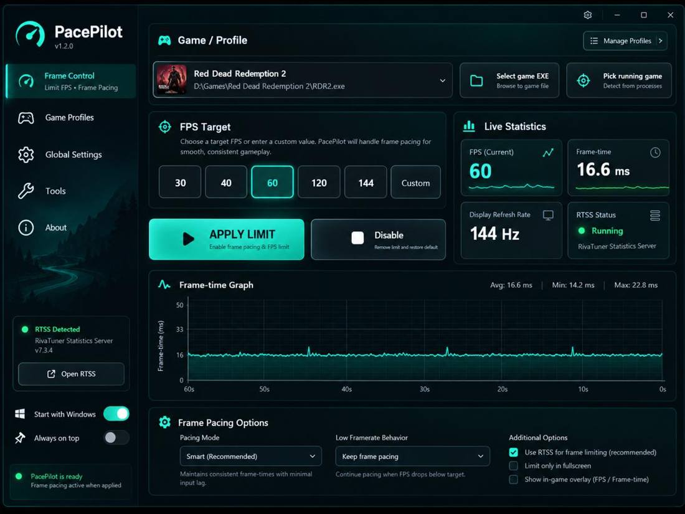
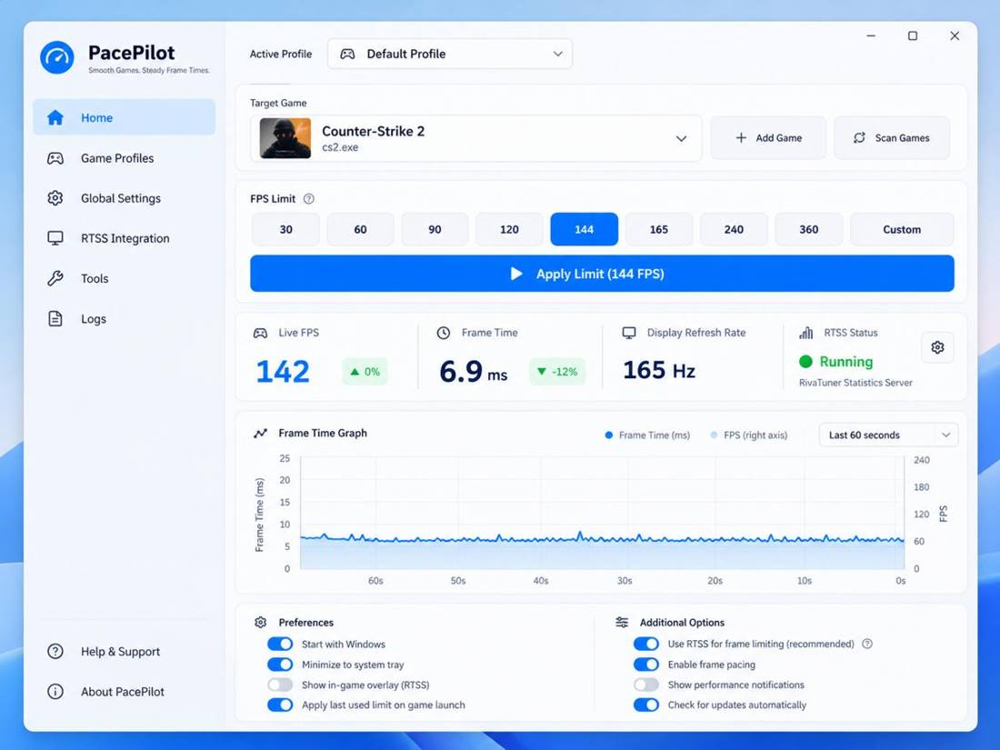
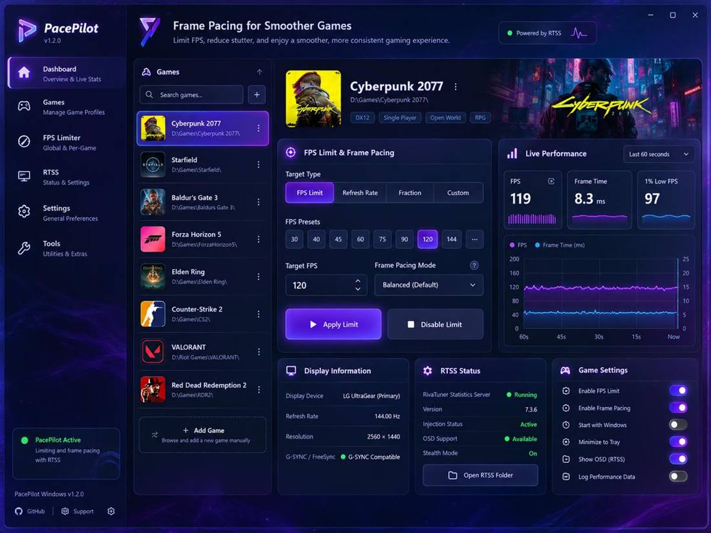
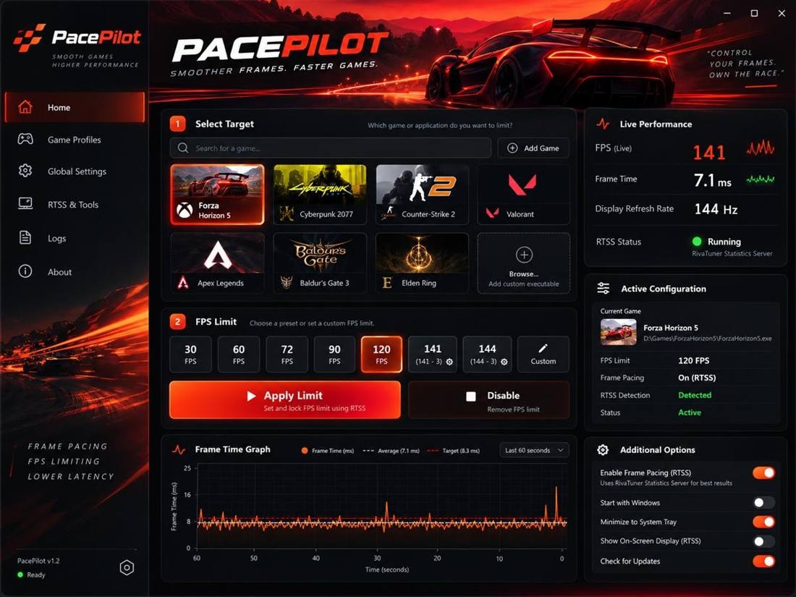
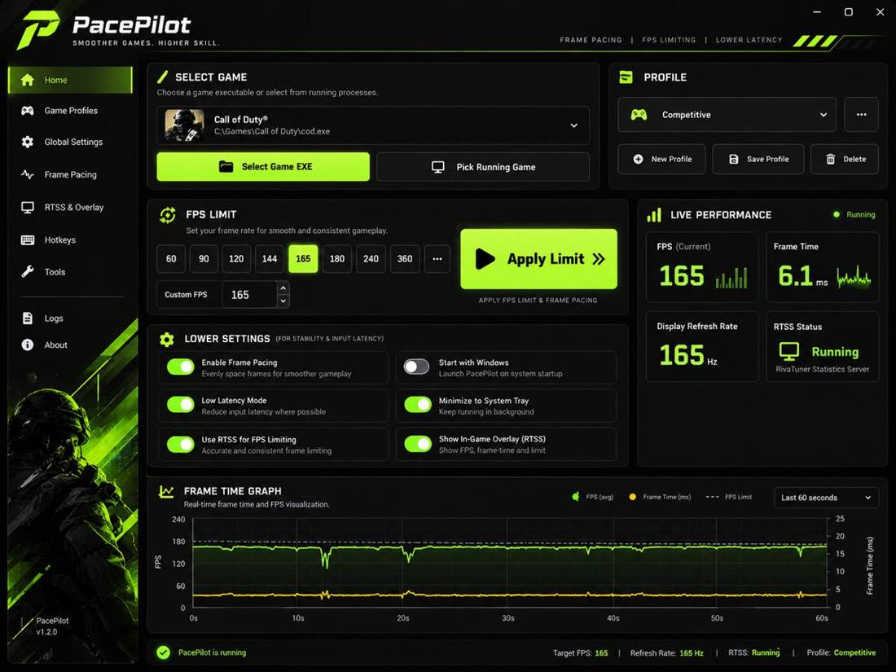
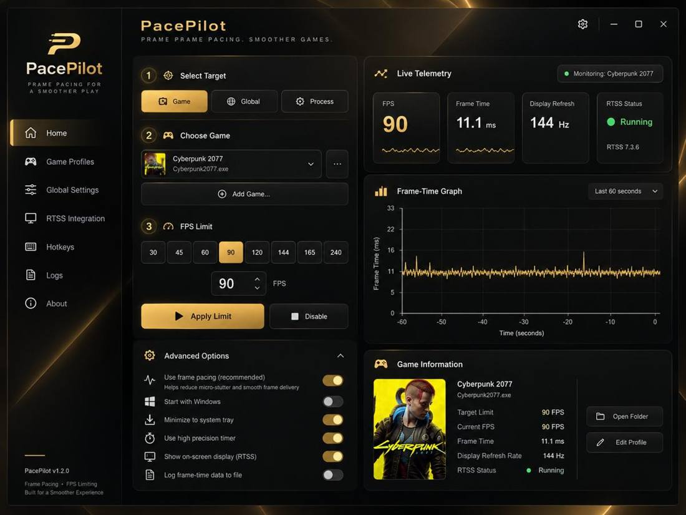

# PacePilot Studio 2.2 | نرم‌افزار کنترل فریم ویندوز

### Performance HUD / پایش و نمایش روی بازی (v2.2)

**One app • six artwork themes • RTSS FPS controls • in-game OSD • CPU/RAM/GPU cards**

Inside **Performance HUD / پایش و نمایش بازی**, use **Alt + Shift + O** to show or hide PacePilot's native RTSS OSD. FPS and the 20-block frametime bar use real RTSS measurements. CPU and RAM are read using native Windows counters. For GPU load, GPU temperature, core clock, board power, VRAM and motherboard VRM temperatures, enable **Shared Memory Support** under HWiNFO64 Sensors; unsupported readings remain **—**, never fabricated. Overlay visibility depends on RTSS/game compatibility.

Anti-cheat checks now depend on the selected game executable instead of merely the existence of unrelated background anti-cheat services. **PUBG/BattlEye, Valorant and other protected games remain blocked:** PacePilot does not bypass game anti-cheat policies, and an in-game limiter is recommended for such titles.

این نسخه شامل کارت‌های جداگانه CPU، RAM، GPU، دما، کلاک، توان، VRAM و VRM است؛ داده‌های گرافیکی از HWiNFO64 (در صورت فعال بودن Shared Memory Support) خوانده می‌شوند. برای روشن و خاموش‌کردن OSD از **Alt + Shift + O** استفاده کنید. محدودیت ضدتقلبِ بازی‌های محافظت‌شده همچنان رعایت می‌شود و بازبودن سرویس یک بازی دیگر به‌تنهایی سایر بازی‌ها را مسدود نمی‌کند.

Windows CI checks compilation and UI self-tests, not real in-game frame limiting; on-machine validation remains necessary.

### Windows Administrator / اجرای مدیر (v2.1.1)

`PacePilot.exe` now requests **Administrator** via a standard Windows manifest. UAC confirmation is required; FPS updates are verified against RTSS and its saved profile before showing success. Running with Administrator cannot guarantee a silent startup without consent.

نسخه ۲.۱.۱ هنگام اجرای فایل EXE درخواست مجوز Administrator می‌دهد. خطای بررسی زودهنگام حافظه RTSS اصلاح شده است؛ پس از ذخیره، مقدار FPS از فایل پروفایل و API بازخوانی می‌شود. اجرای خودکار بی‌صدا با دسترسی مدیر تضمین نمی‌شود و برنامه UAC را دور نمی‌زند.

**[Website / سایت پروژه](https://mrhamidrouter.github.io/PacePilot/)** · **[Windows ZIP / دریافت ویندوز](https://github.com/MrHamidRouter/PacePilot/releases/latest/download/PacePilot-Windows-x64.zip)** · **[All releases / نسخه‌ها](https://github.com/MrHamidRouter/PacePilot/releases)**

**Developer / توسعه‌دهنده: Mr.HamidRouter** · **Windows 10/11 x64** · **English / فارسی** · **MIT License**

PacePilot is an independent Windows FPS-limiter front end powered by **RivaTuner Statistics Server (RTSS)**. It offers **six selectable artwork themes**, per-game/global FPS caps, RTSS live telemetry, a measured frametime graph, persistent game profiles, global hotkeys, tray controls, and assisted RTSS installation.

PacePilot یک نرم‌افزار مستقل ویندوز برای کنترل FPS با استفاده از RTSS است. **شش پوسته گرافیکی با پس‌زمینه اختصاصی**، تنظیم محدودیت فریم برای هر بازی، نمودار زنده مبتنی بر اندازه‌گیری RTSS، پروفایل‌های ذخیره‌شده، میانبرهای سراسری، اجرای کنار ساعت و نصب هدایت‌شده RTSS دارد.

## Download / دریافت نسخه اجرایی

**One ZIP, no compiling. / فقط یک ZIP، بدون کامپایل**

Get the `PacePilot-Windows-x64.zip` file from a successful [Windows build](https://github.com/MrHamidRouter/PacePilot/actions/workflows/windows-build.yml). Extract it; run `PacePilot.exe` directly if RTSS is installed. Otherwise, run **`Setup-PacePilot.bat` once**. It checks RTSS, installs it via `winget` only when missing, and launches the EXE. Windows may request administrator confirmation.

فایل `PacePilot-Windows-x64.zip` را از [ساخت ویندوزی GitHub](https://github.com/MrHamidRouter/PacePilot/actions/workflows/windows-build.yml) دریافت و استخراج کنید. اگر RTSS از قبل نصب است، `PacePilot.exe` را اجرا کنید؛ در غیر این صورت فقط **`Setup-PacePilot.bat`** را اجرا کنید تا RTSS بررسی و در صورت نیاز از طریق winget نصب شود و برنامه اجرا شود. ممکن است تأیید دسترسی مدیر ویندوز لازم باشد.

The ZIP includes an EXE, one optional setup BAT and two language-specific READMEs; RTSS is downloaded from its package source and is **not** redistributed. Developer: **Mr.HamidRouter**.

## Six fully functional themes / شش طرح قابل‌استفاده

| Theme / طرح | Interface layout / چیدمان |
| --- | --- |
| Neon Teal / فیروزه‌ای | Wide game selector, main limit & statistics, full-width graph |
| Windows Blue / سفید آبی | Spacious stacked Windows 11-inspired dashboard |
| Cyber Purple / بنفش | Dedicated game column, FPS area and telemetry cards |
| Racing Red / قرمز مسابقه‌ای | Hero banner, performance grid and chart |
| Esports Lime / سبز گیمینگ | Competitive layout with side-by-side configuration |
| Graphite Gold / مشکی طلایی | Two-column step-by-step controls and telemetry |

Choose a theme and switch between **English** and **فارسی** from the left sidebar. Both selections are saved in `%APPDATA%\PacePilot\settings.xml` and restored on the next launch. All six skins use the **same real FPS/RTSS backend** and the same stored profiles. / زبان و طرح برنامه از پنل کناری قابل تغییر و ذخیره هستند.

### UI preview gallery / پیش‌نمایش شش طرح

| Neon Teal | Windows Blue | Cyber Purple |
| --- | --- | --- |
|  |  |  |

| Racing Red | Esports Lime | Graphite Gold |
| --- | --- | --- |
|  |  |  |

These concept screenshots guided the six **functional** WinForms layouts; actual UI controls may differ in small details. / این تصاویر نمونه طراحی هستند و ظاهر برخی کنترل‌های واقعی ویندوز ممکن است کمی متفاوت باشد.

## Main features / امکانات

- **FPS caps / محدودکننده فریم:** 30, 40, 60, 90, 120, 144, 165, 240 and custom 0–1000 FPS, 0 = unlimited.
- **Global/per-game profiles / پروفایل اختصاصی هر بازی:** select a game executable or browse visible running processes; remember game-specific FPS values.
- **Measured monitoring / پایش واقعی:** RTSS shared-memory FPS/frametime samples. Missing telemetry shows `--`, not invented readings.
- **Runtime changes / تغییر حین بازی:** apply a new FPS setting via RTSS without reopening PacePilot. A particular game may still restrict external hooks.
- **Hotkeys / میانبرها:** `Alt + Shift + L` toggle; `Alt + Shift + Up/Down` adjust FPS by 1.
- **Tray & startup / کنار ساعت و استارت‌آپ:** minimize to tray, launch on Windows startup, always on top.
- **Anti-cheat precautions / هشدار ضدتقلب:** blocks known protected processes and warns before global changes. Detection cannot guarantee compatibility.
- **RTSS management / مدیریت RTSS:** search for an existing installation, offer consent-based `winget` installation of `Guru3D.RTSS`, manual folder selection, official download fallback, diagnostics.
- **Tests / تست:** self-test for theme layouts, responsive layout, presets, language switching and RTSS configuration parser. CI on Windows compiles the project and runs the test. Real-world gameplay and RTSS interaction require a Windows PC.

## RTSS setup / نصب RTSS

If RTSS is missing, PacePilot asks before doing anything. If the user approves, Windows Package Manager runs `winget install --id Guru3D.RTSS --exact --source winget --silent --accept-package-agreements --accept-source-agreements --disable-interactivity` with a Windows UAC prompt when necessary. `winget` verifies its installer package according to its manifest. If installation fails or is refused, [Guru3D's RTSS download page](https://www.guru3d.com/download/rtss-rivatuner-statistics-server-download/) is offered. RTSS binaries are **not** redistributed with PacePilot.

در نبود RTSS، برنامه ابتدا اجازه می‌گیرد؛ پس از تأیید کاربر با `winget` تلاش به نصب می‌کند. در صورت شکست، مسیر دانلود رسمی معرفی می‌شود. هیچ فایل اجرایی RTSS در بسته بازنشر نمی‌شود.

## Build locally / ساخت از سورس

Double-click `Start-PacePilot.cmd` on Windows 10/11 x64. The script finds Microsoft's .NET Framework C# compiler, builds a uniquely named EXE to avoid file-locking, executes `--selftest`, and launches the verified build. Files in `Docs/` are optional helpers; users need only the single launcher. The workflow produces `Bin/PacePilot.exe` for the Actions artifact.

روی ویندوز ۱۰/۱۱ نسخه ۶۴ بیتی، فایل `Start-PacePilot.cmd` را اجرا کنید. این فایل ساخت برنامه و تست را یکجا انجام می‌دهد. نیازی به اجرای چند فایل CMD نیست.

## Scope and limitations / محدودیت‌ها

PacePilot is **not a reimplementation of the proprietary FramePacer engine** and is not affiliated with FramePacer, pacerio, RTSS or Guru3D. The app relies on separately installed RTSS for actual FPS limiting and monitoring. **NVIDIA Reflex, DLSS Frame Generation / Dynamic MFG, ReShade injection, controller-driven navigation, proprietary multi-API injection and Microsoft Store protected-game interoperability are not implemented.** Do not interpret the UI mockups as evidence of these features. Smoothness depends on the game's engine, RTSS compatibility, and your hardware. An FPS cap cannot eliminate all stuttering.

PacePilot موتور اختصاصی FramePacer را کپی نمی‌کند. قابلیت‌های Reflex و DLSS Frame Generation و موارد وابسته به موتور اختصاصی **پیاده‌سازی نشده‌اند**. ادعای حذف کامل لگ یا سازگاری با همه بازی‌های آنلاین وجود ندارد. در بازی‌های دارای ضدتقلب از محدودکننده خارجی بدون بررسی قوانین بازی استفاده نکنید.

## License

PacePilot source: MIT. Third-party RTSS: separately licensed by its publisher. Theme concept mockups are visual previews, not executable interfaces.

## PacePilot Studio 2.1 / نسخه ۲.۱

- Embedded artwork from the six approved theme concepts / پس‌زمینه تصویری شش پوسته در فایل EXE.
- Local Steam, Epic Games and GOG game detection / شناسایی بازی‌های نصب‌شده.
- Official GitHub Releases update notifications / بررسی نسخه جدید گیت‌هاب.
- RTSS protected-profile UAC-assisted save, with explicit consent / رفع خطای دسترسی پروفایل RTSS با مجوز محدود.
- Download one ready-to-use ZIP from [Releases](https://github.com/MrHamidRouter/PacePilot/releases).

**Developer: Mr.HamidRouter**

## PacePilot 2.3 — Premium themes, live frame activity, and RAM readiness

The **existing RTSS limiter, OSD hotkey, game library, saved profiles, and update checks remain in one executable.** The main dashboard now follows the same consistent layout in all **six embedded-artwork themes**; cards, borders and banner accents change to match each theme. These are native Windows controls built from the concepts, **not rasterized screenshots or a promise of pixel-perfect mockup reproduction**.

### Real frametime feed
The animated **Frame Activity** strip and **Frame-Time History** graph are driven by the same actual RTSS per-game frame samples. **FPS limit applied** and **RTSS process running** do not establish that a game-render hook is active. When no valid target-game samples arrive, the graph stays empty and an explicit **Awaiting RTSS game hook** message is shown instead of fabricated motion. Avoid selecting helper executables such as `UnrealCEFSubProcess.exe`; select the real game process. Protected games may not support injected RTSS OSD.

### Safe pre-game memory check
Select **Prepare / Inspect** in the **Pre-game RAM readiness** panel to view physical RAM and optionally trim **PacePilot's own** working set. **Heavy apps** lists visible user applications using significant memory, without force-closing anything. Launch games using your normal Steam/Epic shortcut after the check. PacePilot **does not** flush Windows standby memory, change memory quotas, kill background services, or promise FPS improvements. This button is optional and does not run at Windows startup.

GPU / VRM telemetry still depends on available HWiNFO64 shared-memory sensors. Missing measurements show **—**.

## نسخه ۲.۳ — شش پوسته، نمودار فریم واقعی و آمادگی رم

موتور کنترل FPS قبلی، کتابخانه بازی‌ها، OSD با میانبر `Alt + Shift + O`، پروفایل‌ها و بررسی آپدیت **در همان فایل اجرایی حفظ شده‌اند**. صفحه اصلی اکنون برای هر شش پوسته ساختار هماهنگی دارد و از تصاویر تعبیه‌شده، رنگ‌بندی اختصاصی و کارت‌های گرافیکی استفاده می‌کند. این رابط کنترل‌های قابل‌استفاده ویندوز است و **تصاویر طراحی‌شده صرفاً مرجع بصری‌اند؛ انطباق پیکسلی تضمین نمی‌شود**.

### نوار فعالیت Frame Time
نوار فعالیت و نمودار فقط از **نمونه‌های واقعی RTSS** به‌روزرسانی می‌شوند. نصب و اجرای RTSS یا ذخیره محدودیت FPS به‌معنای دریافت خودکار اطلاعات فریم بازی نیست. اگر بازیِ انتخاب‌شده اتصال Render Hook نداشته باشد، به‌جای نمایش داده ساختگی، پیام «در انتظار اتصال RTSS به بازی» دیده می‌شود. فایل‌های کمکی مانند `UnrealCEFSubProcess.exe` را به‌عنوان فایل اصلی بازی انتخاب نکنید. نمایش OSD روی بازی‌های دارای ضدتقلب تضمین نمی‌شود.

### بررسی رم قبل از بازی
با دکمه **بررسی و آماده‌سازی** می‌توان حافظه فیزیکی را ارزیابی کرد و حافظه کاری **خود PacePilot** را (اختیاری و به درخواست کاربر) کاهش داد. گزینه **برنامه‌های پرمصرف** موارد سنگینِ قابل‌مشاهده را معرفی می‌کند. هیچ برنامه‌ای به‌زور بسته نمی‌شود؛ کش/Standby ویندوز دستکاری نمی‌شود و افزایش FPS تضمین نیست. پس از بررسی، بازی را از طریق Steam یا میانبر عادی اجرا کنید.

اطلاعات GPU و VRM از حسگرهای واقعی HWiNFO64، در صورت موجود بودن، گرفته می‌شود؛ داده ناموجود با «—» نمایش داده می‌شود.

## v2.4 — Native premium UI rendering (no screenshot wallpaper)

PacePilot no longer stretches or crops the design mockup screenshots behind its Windows controls. The six selectable looks — Neon Teal, Windows Blue, Cyber Purple, Racing Red, Esports Lime and Graphite Gold — are now drawn with native scalable gradients, themed sidebars, rounded metric tiles, and a vector hero. The theme gallery previews actual visual primitives rather than thumbnails of concept screenshots. The real RTSS frame-time graph includes a measured-only fill and an explicit **Waiting for verified RTSS frame data** state when there are no rendering samples. FPS controls, game scanning, OSD hotkey, hardware sensors, safe pre-game RAM check and update detection remain in the same EXE.

**Scope:** This is a practical native visual redesign, not a 1:1 raster recreation of the original concept images. Windows CI verifies build/UI controls; live gameplay and display quality still need on-device checks.
